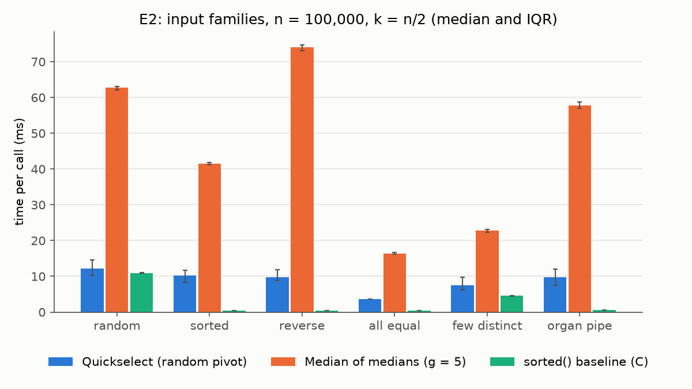

# Individual Reflection: Thanh Trung Le - 14716322

Programming Assessment 2, median of medians

## 1. Worst case and what kind of input triggers it?

Theoretically, the median of medians algorithm does not have any input that makes it above O(n), so the worst case here is the input with the highest constant factor.

For instance, in Experiment 2, with n = 10^5, reverse has the longest time per call with 74ms compared to random (62.8ms) and organ pipe (57.8ms). I think the reason for this is that the sort algorithm used in a group of 5 was Insertion sort, the sort algorithm that works by comparing an element with the elements to the left until the correct position is found to stop. So, according to this interpretation, if an array of 5 elements is reversed, then the insertion sort will compare elements at the left, which is 10 comparisons for an array with 5 elements against only 4 comparisons for a sorted group. Moreover, if the entire array is reversed, it means that the recursive call on the medians also sees a reversed group, and each group again costs 10 comparisons. So it means that every step will meet the worst case if the array is reversed.

## 2. What was the hardest bug or design decision you encountered, and how did you resolve it?

The hardest problem was the two bugs I added in the code (mutants) but the tests did not catch.

1. I used mutation testing with Claude suggesting mutants. The first mutant used `medians[0]` as a pivot instead of recursive calls. The test still passed since partition gives the correct answer with any pivot, but on sorted input, pivot is the third smallest element, so each round only eliminates a few elements, so the running time becomes O(n^2). The only sign was that the test took 51s instead of 4s.
2. The second mutant removed `group_size = group_size` from the recursive call, so the deeper levels used the default of 5. With g = 3, only the top layer uses a group of 3, so Experiment 4 will not really measure g = 3. The result would be similar to g = 5 and would likely make P4 look true.

To fix this, I added a test that the number of comparisons stays below 30n on every input, and a test that uses monkeypatch to check `group_size` in every recursive call. Both mutants are now caught. Consequently, the tests only check the answer, and cannot catch a complexity bug, because an algorithm with the wrong complexity still returns the right answer.

## 3. If you did this implementation again from scratch, what would you do differently?

First, I would write the cost test together with the correctness tests, not after mutation testing because an algorithm with wrong complexity still passed the tests. Secondly, my implementation builds new lists in every round: a slice for each group of 5, a list of medians, and new less, equal, and greater lists. In experiment 1, median of medians was 4.4 to 5.6 times slower than quickselect, but it made only about twice as many comparisons (10n vs 5n). So most of the gap is Python overhead from building lists. So I would partition in place, using indices on one array and swapping elements, so that no new lists are built.

## 4. What's one thing about your algorithm that you did not fully understand before starting, and now do?

At first, I thought median of medians O(n) would be faster than Quickselect O(n log n) since O(n) is faster than O(n log n). Now I understand that both are O(n), the only difference is that quickselect is O(n) in expectation with O(n^2) worst case, while median of medians guarantee O(n) on every input. In addition, median of medians used 10n comparisons, while quickselect only used 5n comparisons in Experiment 1. So a linear worst case does not mean fast since the guarantee costs a larger constant factor.