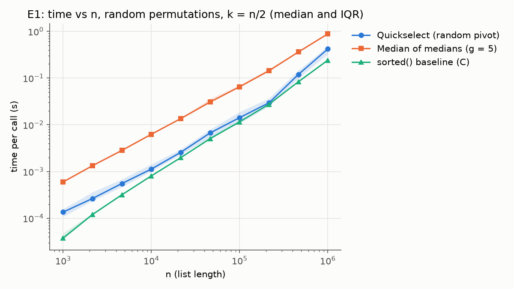
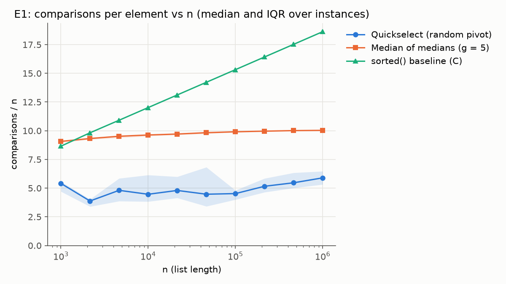
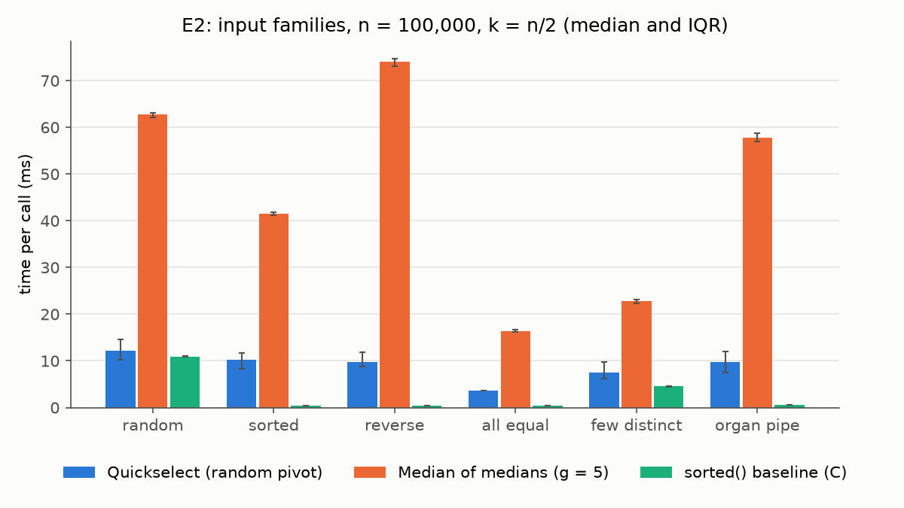
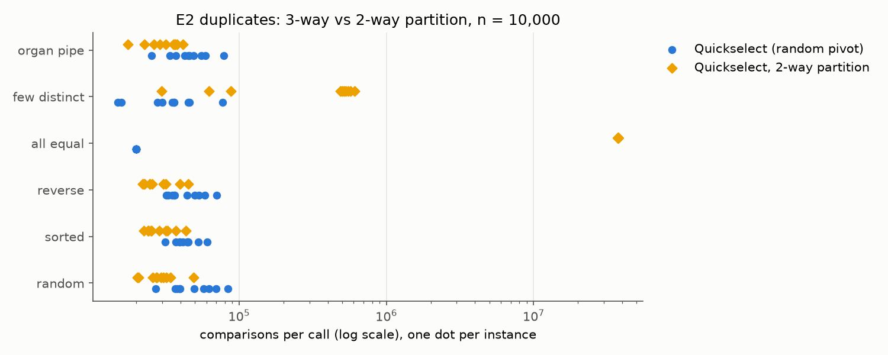
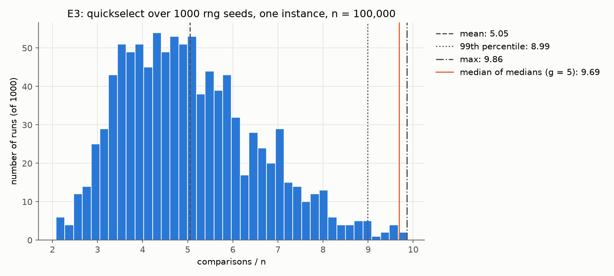
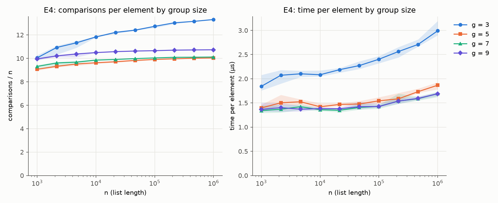
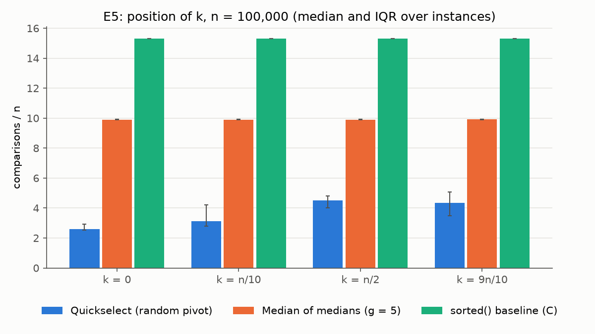
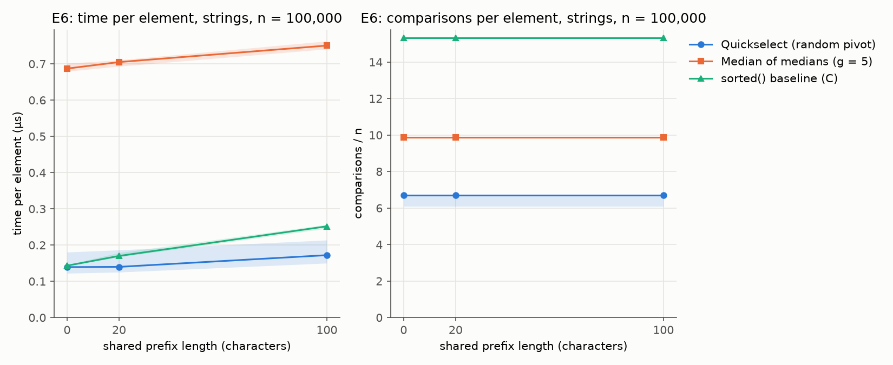

# Median Finding: Randomized Quickselect vs Deterministic Median of Medians

UTS 41052 Advanced Algorithms, Programming Assignment 2, Theme 2 (deterministic vs randomized).
An Loc Nguyen and Thanh Trung Le.
Repository: https://github.com/alngxx/median-finding-benchmark
Video: [unlisted YouTube link]


## 1. The problem and the algorithms


### The problem (An Loc)

Selection takes an unsorted list of n comparable values and an index k (0-indexed) and returns the k-th smallest value. The median is k = n // 2. Sorting the list and reading element k takes O(n log n) time, but it orders far more than the question needs, and both of our algorithms aim for O(n). They share one contract, `select(a, k, rng)`, which raises `ValueError` for an empty list or k out of range and compares elements only with `<` and `==`, so one wrapper counts the comparisons of both algorithms in the same way (README.md).

### Randomized quickselect (primary author: An Loc Nguyen)

Quickselect (Hoare, 1961) repeats one round until it can answer. A round picks a pivot uniformly at random with `rng.randrange`, then splits the current list into three parts using only `<` and `==`: the elements less than the pivot, equal to it, and greater than it. If k is below the size of the less part, the loop continues with the less part. If k falls inside the equal part, the pivot is the answer. Otherwise the loop continues with the greater part, and k is reduced by the sizes of the less and equal parts. The loop is iterative, because Python's recursion limit is 1,000 (CLAUDE.md).

**Expected time.** A pivot lands in the middle half of the elements with probability 1/2, and then the next list has at most 3/4 of the elements. Counting a bad pivot as a round that does not shrink the list, the expected work satisfies T(n) <= n + T(n)/2 + T(3n/4)/2. This gives T(n) <= 2n + T(3n/4), so T(n) <= 8n element visits. The bound is loose: the measured number of element visits (the `<` count) averages about 3.4n at k = n/2 (3.38n over 300 seeds, Section 4.5). An Loc read CLRS section 9.2 alongside this argument. The worst case is O(n^2), but it needs a long run of bad pivots, so its probability is tiny.

**Duplicates and counting.** The 3-way split removes every element equal to the pivot in one round. A 2-way partition does not: on a list of all equal values with n = 10^4, `select` used 20,000 comparisons and `select_two_way` used 37,502,499 (results/e2.csv, part e2_dup). Our 3-way split costs 1 comparison for an element less than the pivot and 2 otherwise (`<`, then `==`).

### Median of medians (primary author: Thanh Trung Le)


Median of medians (Blum, Floyd, Pratt, Rivest and Tarjan, 1973) uses the same loop as quickselect: pick a pivot, split the list into the elements less than, equal to and greater than the pivot, and keep only the part that holds the k-th smallest value. The difference is how the pivot is chosen. Quickselect picks it at random and relies on luck. Median of medians spends work on the choice, so that the pivot is never bad.

Each round works like this:

1. If the list has at most 25 elements (`BASE_CUTOFF`), sort it with insertion sort and return element k.
2. Split the list into groups of 5. Sort each group with insertion sort and take its middle element.
3. Call the algorithm recursively on the list of group medians to find their median. This value is the pivot.
4. Partition the list into less, equal and greater, and continue in the part that holds k.

**Why the pivot is always good.** Half of the group medians are at most the pivot. Each of those groups has 3 elements that are at most its median, and so at most the pivot. That gives at least about 3n/10 elements on the low side of the pivot, and by the same argument at least about 3n/10 on the high side (more precisely, at least 3n/10 - 6; Cormen et al., 2009, section 9.3). So whatever the input, the part we keep has at most about 7n/10 elements.

**Complexity.** Finding the pivot costs a recursive call on n/5 medians, the next round works on at most 7n/10 elements, and grouping and partitioning cost O(n):

T(n) <= T(n/5) + T(7n/10) + O(n)

Because 1/5 + 7/10 = 9/10 < 1, the work shrinks by a constant factor at each level and the total is O(n) in the worst case, for every input. With groups of 3 the same argument gives T(n/3) + T(2n/3) + O(n). The fractions sum to 1, so each level costs about the same and the total becomes O(n log n). Experiment E4 tests this. The extra memory is O(n) for the less, equal and greater lists.

**What makes it different.** Quickselect is O(n) only in expectation and can take O(n^2) on an unlucky run. Median of medians guarantees O(n) and gives the same result and the same cost on every run, but it pays for the guarantee with a larger constant: every round sorts all the groups and makes an extra recursive call just to choose the pivot.

**Our implementation.** Only the pivot step is recursive. Continuing into less or greater is a loop, so the recursion depth grows with the logarithm of n, base 5, and stays small. Elements are compared only with `<` and `==`, so the comparison counter treats both algorithms the same. The group size is a parameter (`group_size`, an odd integer of at least 3, default 5), and the cutoff of 25 is the same for every group size so that E4 compares group sizes alone.

## 2. Theoretical comparison and predictions (An Loc & Trung)


| | Randomized quickselect | Median of medians (g = 5) |
|---|---|---|
| Time, expected | O(n) | O(n) |
| Time, worst case | O(n^2), with tiny probability | O(n) |
| Same cost on every run? | No, depends on the random pivots | Yes |
| Work per round | one partition pass | sort every group of 5, find the median of medians recursively, then one partition pass |
| Extra memory | O(n) for the less, equal and greater lists | O(n) for those lists plus the medians list |
| Sensitive to input order? | No, the pivot is random | Yes, through the insertion sorts inside groups |
| Sensitive to duplicates? | 3-way partition removes every element equal to the pivot | the same |
| Sensitive to the position of k? | Yes, in expectation | Little, the pivot is near the median for any k |


Quickselect does one partition pass per round and no other work, so a round costs about the length of the current list (the counting rule is in Section 1). The total varies from run to run because the pivots are random, and it does not depend on the order of the input, because the pivot is random. Duplicates make it cheaper, since the 3-way partition drops every element equal to the pivot. Its cost depends on k in expectation: with a random pivot, a k near an end lets each round discard more of the list.

Median of medians does much more work per round. Before its partition pass, it sorts every group of 5 with insertion sort (up to 10 comparisons per group), builds a list of n/5 medians and calls itself on that list. So its constant factor should be larger than quickselect’s, even though both are O(n). Unlike quickselect, it makes no random choices, so it costs the same on every run. Its cost depends on input order through the insertion sorts, and reversed groups cost the most. The position of k should matter little, because the pivot is close to the true median whatever k is.

### Predictions (locked before the experiments)

The predictions below were written before the official run and locked with the git tag `predictions-locked` (commit 3ae1dd7). They are copied unchanged. The locked predictions were first drafted by Claude Code from the structure of the algorithms, then reviewed and edited by An Loc. An Loc saw no experiment results before they were locked, apart from the two numbers disclosed in the Authorship note of report/predictions.md. Thanh Trung's draft, written after he saw rough numbers from a pilot run, is recorded in `report/predictions.md` but was not used. The section "Differences with Trung's draft" of `report/predictions.md`, added in the lock commit 3ae1dd7 under the git name Taki (Thanh Trung Le), contains the statement "Changes An Loc made: none". That statement is not accurate: the first draft was written by Claude Code, and An Loc then edited it. The Claude Code session that drafted them reported that it had run experiments E1 to E6 in --quick mode into a scratch folder and read only row counts and algorithm names (self-reported; see the Authorship note in report/predictions.md); An Loc saw no results from those runs. The corrected Authorship and Differences text, with a table comparing the two drafts, is on the branch backup-predictions (commits 7d5380b and affc099), which the locked file does not contain.

#### P1: Which algorithm is faster on random inputs, and by what factor?

- Prediction: Quickselect is faster by 2x to 5x.

- Reason (one line): Median of medians sorts every group and builds extra lists, and in pure Python that overhead costs more than quickselect's single pass per round.

#### P2: Are both algorithms linear on a log-log plot?

- Prediction: The slope of a log-log plot of time vs n is between 0.9 and 1.2 for both algorithms.

- Reason (one line): Quickselect is linear in expectation and median of medians is linear in the worst case, so only constant factors differ.

#### P3: How wide is the spread of quickselect comparison counts?

- Prediction: The maximum over 1000 seeds is 1.5 to 3 times the mean.

- Reason (one line): One bad early pivot keeps most of the list, so the count has a long right tail, but a pivot that bad is rare at n = 10^5.

#### P4: Does median of medians with g = 3 grow faster than with g = 5?

- Prediction: Slightly, but the difference is hard to see on the plot.

- Reason (one line): The worst case with g = 3 is n log n, but random input gives pivots far better than the worst case, so the curve stays close to linear.

#### P5: How does g = 7 compare with g = 5?

- Prediction: g = 7 and g = 5 are within 10% of each other in time.

- Reason (one line): A larger group costs more to sort per element, but it leaves fewer medians to recurse on, and the two effects roughly cancel.

#### P6: Does `sorted()` beat both algorithms?

- Prediction: sorted() beats both algorithms at small n. At n = 10^6, quickselect is within 2x of sorted() and might beat it.

- Reason (one line): sorted() is n log n but runs in C, while quickselect does a few linear passes in Python.

Most uncertain prediction.

#### P7: What is the worst input family for each algorithm?

- Prediction: Quickselect: all_equal and few_distinct are the cheapest families. random, sorted and reverse_sorted are within 10% of each other in time and comparisons. Median of medians: reverse_sorted is the most expensive, because insertion sort on reversed groups does the most swaps.

- Reason (one line): The 3-way partition removes every element equal to the pivot, so duplicates shrink the list quickly, and a random pivot ignores input order.

#### P8a: Does the position of k change quickselect's cost (E5)?

- Prediction: Quickselect is cheaper at k = 0 and k = 9n/10 than at k = n/2, in time and in comparisons.

- Reason (one line): With a random pivot, a k near an end lets each round throw away more of the list in expectation.

#### P8b: Does the position of k change median of medians' cost (E5)?

- Prediction: Median of medians is within 10% across k = 0, n/10, n/2 and 9n/10.

- Reason (one line): The pivot is near the median whatever k is, so each round keeps about half of the list for any k.

#### P9a: Do shared prefixes change the comparison counts (E6)?

- Prediction: For the same seed, comparison counts are identical across prefix lengths.

- Reason (one line): The prefix is the same for every string, so it does not change which string is smaller, and the seeds do not depend on the prefix length.

#### P9b: Do shared prefixes change the time ratio between the algorithms (E6)?

- Prediction: The ratio of running times between the two algorithms changes by less than 20% across prefix lengths.

- Reason (one line): The prefix changes the cost of each comparison and not their number.

#### P9c: Do shared prefixes change the running time (E6)?

- Prediction: Running time at prefix length 100 is within 30% of prefix length 0 for both algorithms.

- Reason (one line): Python compares strings in C, so interpreter overhead dominates.

## 3. Experimental methodology (Trung)


All experiments run through one script, `bench/run_bench.py`, and every figure comes from `bench/plot.py` reading the committed CSV files in `results/`. The commands are:

```
python -m bench.run_bench all
python -m bench.plot
```

The official run (commit 3cc528c) took 1,553 s (about 26 minutes) on the machine described below.

### Input families

All generators are in `bench/generators.py`. Each takes a size n and a seed and uses its own `random.Random(seed)`, so every instance can be regenerated exactly.

| Family | Content | Why we include it |
|---|---|---|
| random | random permutation of 0 to n - 1 | the typical case |
| sorted, reverse | 0 to n - 1 ascending, or descending | tests whether the order of the input matters |
| all equal | n copies of 0 | the extreme case of duplicates; separates the 3-way and 2-way partitions |
| few distinct | n values drawn from 0 to 9 | many duplicates, but not all equal |
| organ pipe | rises to a peak in the middle, then falls | a structured order that is neither sorted nor random. For even n the peak value appears twice (n = 6 gives 0 1 2 2 1 0) |
| strings | a fixed prefix of 0, 20 or 100 letters, then 10 random letters | makes each comparison more expensive without changing the order |

### Experiments

| ID | Question | Setup |
|---|---|---|
| E1 | How do both algorithms scale? | random, k = n/2, 10 sizes from 10^3 to 10^6 spaced evenly on a log scale, 10 instances per size |
| E2 | Which inputs hurt which algorithm? | all six integer families at n = 10^5, k = n/2, 10 instances. A second part compares quickselect's 3-way partition with a 2-way partition on the same six families at n = 10^4 |
| E3 | How long is quickselect's tail? | one fixed random instance, n = 10^5, k = n/2, run with random seeds 0 to 999, comparison counts only |
| E4 | Why groups of 5? | median of medians with group size 3, 5, 7 and 9, same sizes and instances as E1 |
| E5 | Does the position of k matter? | random, n = 10^5, k = 0, n/10, n/2 and 9n/10, 10 instances |
| E6 | What changes when comparisons are slow? | strings with prefix length 0, 20 and 100, the E1 sizes up to 10^5, k = n/2, 5 instances |

E1, E2, E5 and E6 run quickselect, median of medians (group size 5) and the `sorted(a)[k]` baseline. The baseline is not one of the compared algorithms. It is Python's built-in Timsort, written in C, and it shows how pure-Python selection compares with the practical choice.

Two sizes differ from our first plan. The 2-way partition part of E2 runs at n = 10^4, not 10^5: on all-equal input the 2-way partition removes one element per round, which is about 0.375 n^2 comparisons (37,502,499 measured at n = 10^4). One such call took 1.24 s at n = 10^4, so at n = 10^5 each call would take about 2 minutes and that part alone about 2.5 hours. E6 stops at n = 10^5 with 5 instances to keep the full run under half an hour. A seventh experiment we planned, E7 (a McIlroy-style adversary), was dropped for lack of time (section 6).

### Measurement

- **Machine.** AMD Ryzen 9 6900HS Creator Edition, 8 cores, 16 logical processors, L1 cache (512 KB), L2 cache (4 MB), L3 cache (16 MB), Windows 11 Home, CPython 3.13.1 in a virtual environment, Power mode set to Best performance, plugged in, screen on, no other programs running.
- **Timing.** Each input is generated and copied before the timer starts, so we time the algorithm, not the generator. Each configuration gets one untimed warm-up run, then 5 timed runs with `time.perf_counter`, with Python's garbage collector switched off during each call. Every run is stored, and the figures show the median with the interquartile range, not only an average.
- **Comparison counts.** A separate, untimed run wraps every element in a `Counted` object (`bench/counting.py`) whose `<` and `==` add to a counter, and any other comparison raises an error. Counts do not depend on the machine, so they let us check explanations that timing alone cannot. We count every real `<` and `==`. Our 3-way partition costs 1 comparison for an element less than the pivot and 2 otherwise, so our counts can be up to twice a textbook count, which charges 1 per element. For this reason we do not test the textbook figures of about 1.5n comparisons for Floyd-Rivest (Floyd & Rivest, 1975) and about 2n for any deterministic algorithm directly (Bent & John, 1985). Median of medians also counts the comparisons inside its insertion sorts.
- **Random seeds.** Instance i uses generator seed i. Quickselect's timed runs use seeds 1000i to 1000i + 4, and its counting run uses seed 1000i, so every run can be repeated exactly.

### Correctness and fairness

- Every answer, timed or counted, is checked against `sorted(a)[k]` before it is stored, and on every instance quickselect and median of medians must return the same value. Any mismatch stops the run.
- Both algorithms are pure Python, share one interface (`select(a, k, rng)`), receive the same instances, and compare only with `<` and `==`.
- The test suite has 207 tests, including edge cases (one element, all equal, two values, sorted, reverse, negative numbers, floats, strings) and error cases. We also used mutation testing: we deliberately inserted bugs to check that the tests catch them. Two bugs in median of medians gave correct answers and passed the first version of the tests: choosing the first group median as the pivot, which loses the O(n) guarantee, and ignoring the group size in the recursive call, which would have made E4 wrong. We added a test that comparisons stay below 30n on every input family and a test of the group size passed to the recursive call, and both bugs are now caught.

### Checking that the timings are trustworthy

Our first official run (commit 4f701e8) had to be discarded. The same configuration (random input, n = 10^5, k = n/2) is timed in several experiments, so its time should agree across them. In that run median of medians took 64 ms in E1 but 154 ms in E4 and 161 ms in E5: the processor slowed down during the run, most likely because Windows reduced performance after the screen turned off. We re-ran everything with the settings above. In the official run the same configuration agrees within 4% for median of medians (63 to 65 ms across E1, E2, E4 and E5) and for `sorted()` (10.9 to 11.6 ms). Quickselect varies more: the identical computation took 14.2 ms in E1 and 11.8 ms in E5. Comparison counts were identical in both runs, as expected with fixed seeds.

### Predictions and the pilot run

The predictions in section 2 were committed and tagged `predictions-locked` in git before the official run, and the git history shows the order. Before that, while testing the harness, we saw rough numbers from small pilot runs, and one full run was started by mistake before the tag; that output was moved out of the repository without being analysed. Also, Thanh Trung was told a few rough findings from these pilots: median of medians was about 2 to 4 times slower than quickselect, sorted() was about as fast as quickselect, median of medians used about 4n to 12n comparisons and took about 1.2 s at n = 10^6, comparisons per element grew with n for g = 3 but not for g = 5, 7 and 9, and in E6 the counts stayed the same while time rose. Claude, the AI assistant he used, saw more detailed pilot figures. The full list, with dates, is in `notes/pilot-numbers-seen.md`. Every number in this report comes from the official run.

## 4. Results and analysis


### 4.1 Scaling (E1) (Trung)






Both algorithms are linear in practice, but with very different constants. The log-log slope of time against n is 1.05 for median of medians and 1.13 for quickselect. Up to n = 2.15 * 10^5, median of medians is 4.4 to 5.6 times slower (65.1 ms against 14.2 ms at n = 10^5). Comparison counts explain part of this: median of medians uses 9.1n to 10.0n comparisons, about twice quickselect's 3.9n to 5.9n, because every round sorts all groups of 5 before it partitions. The rest is Python overhead that counts do not see: slicing the groups, building the list of medians and the recursive call.

Above 2.15 * 10^5 the gap shrinks to 3.0 and then 2.1 times at 10^6. Quickselect's time per element jumps from 137 ns to 420 ns while its comparisons per element barely move, so it is not doing more work. Section 5.1 shows that memory layout explains about half of this jump.

`sorted()` is faster than quickselect at every n, by 1.07 times at its closest (n = 2.15 * 10^5) and 1.74 times at 10^6, although it makes 2 to 3 times more comparisons (8.7n rising to 18.6n). Timsort runs each comparison in C, while both selection algorithms pay the Python interpreter for every one. P1 nearly held (the ratio exceeded 5 at some sizes), P2 held, and P6 held, but quickselect never beat `sorted()`.

### 4.2 Input families (E2) (Trung)






For quickselect, the order of the input hardly changes the work: random, sorted and reverse cost 4.52n, 4.41n and 4.06n comparisons, because a random pivot ignores the order. Their median times differ more (12.3, 10.3 and 9.8 ms), but the interquartile ranges overlap heavily (10.2 to 14.7 ms against 8.2 to 11.8 ms for random and sorted), and identical runs of quickselect varied by about 20% between experiments (section 3). Our memory-layout check found no layout effect at this size (`analysis/trung_memory_layout.md`, ratio 0.98 at n = 10^5), so we treat these time differences as noise. Duplicates make quickselect cheaper, as predicted: all equal costs exactly 2n (one round) and few distinct 4.20n.

Median of medians depends on order through its insertion sorts. Reverse input is the most expensive (11.41n comparisons, 74.0 ms) because every group arrives reversed, and sorted input the cheapest of the distinct families (7.37n, 41.5 ms). Here time follows comparisons closely.

The duplicates part confirms why we need a 3-way partition. On all equal input at n = 10^4 the 2-way partition makes 37,502,499 comparisons, 0.375 n^2, and takes 1.24 s, against 20,000 comparisons and 0.4 ms for the 3-way partition. On distinct values the 2-way version is slightly cheaper, because it pays 1 comparison per element instead of up to 2. P7 held for comparisons; its claim that random, sorted and reverse stay within 10% in time is not supported, since the medians differ by up to 25%, though within the noise of quickselect's timings.

### 4.3 Quickselect's tail (E3) (An Loc)





The figure `figures/e3_quickselect_tail.png` shows the comparison counts of 1000 runs of quickselect on one instance (n = 10^5, k = n/2), one run per rng seed. All numbers in this subsection come from analysis/anloc_numbers.md, which reads results/e3.csv.

The mean is 505,000 comparisons (5.05 per element) and the median is 487,000 (4.87 per element), so the distribution is skewed to the right. The standard deviation is 1.49 per element. The 99th percentile is 8.99 per element, and the maximum is 986,000 comparisons (9.86 per element), which is 1.95 times the mean. The minimum is 2.08 per element. Every run uses the same instance, so all of this spread comes from the random pivots. A likely reason for the long right tail is that a bad early pivot keeps most of the list for another full pass, while a good one removes about half; we did not test this explanation.

Median of medians, which makes no random choices, used 969,000 comparisons (9.69 per element) on the same instance. Quickselect used fewer comparisons than median of medians in 998 of the 1000 seeds, and did not in the remaining 2. The unlucky tail of quickselect therefore reaches the cost of median of medians but almost never passes it.

Prediction P3 (maximum between 1.5 and 3 times the mean) held: the measured ratio is 1.95.

### 4.4 Group size (E4) (Trung)





Groups of 3 lose linearity, and it is visible within our range. From n = 10^3 to 10^6, comparisons per element rise from 10.05 to 13.32 (+33%) for g = 3, against 9.07 to 10.03 (+11%) for g = 5. This matches the recurrences: with g = 3 the pivot step and the next round cover 1/3 + 2/3 = 1 of the list, so every level of the recursion costs about the same and the total grows like n log n; with g = 5 the fractions sum to 9/10, so the levels shrink and the total stays linear. Because comparison counts do not depend on the machine, this check is independent of timing noise. Time per element shows the same pattern (773 to 1,368 ns for g = 3).

Larger groups do not cost more. g = 7 and g = 9 use slightly more comparisons than g = 5 (10.11n and 10.73n at 10^6), because insertion sort on larger groups costs more, yet g = 7 is 4 to 8% faster than g = 5 at every n. A likely reason is that fewer, larger groups mean fewer list slices and Python calls per element; we did not measure this. P4 failed ("slightly, hard to see"), and P5 held.

### 4.5 Position of k (E5) (An Loc)




The table gives the median over 10 instances at n = 10^5, with the minimum and maximum over instances. Time is the median of all 50 timed runs per k (10 instances, 5 runs each), the statistic that `bench/plot.py` uses for its time figures (analysis/anloc_numbers.md, from results/e5.csv).

| k | comparisons per element (median over 10 instances) | min to max over instances | time (ms, pooled median of all 50 timed runs) | time min to max (ms, over the 50 runs) |
|---|---|---|---|---|
| 0 | 2.59 | 2.17 to 3.86 | 6.58 | 4.00 to 33.5 |
| n/10 | 3.14 | 2.43 to 6.46 | 8.49 | 5.00 to 16.7 |
| n/2 | 4.52 | 3.05 to 8.74 | 11.8 | 7.21 to 20.8 |
| 9n/10 | 4.35 | 2.06 to 5.81 | 9.77 | 4.49 to 29.8 |

Median of medians does not depend on k: its median comparisons per element are 9.90, 9.90, 9.91 and 9.92 for the four k, and the largest relative difference across the four k is 0.146% in comparisons and 0.950% in time (same file). With a random pivot, a k near an end lets each round discard more of the list, which fits k = 0 being cheapest and k = n/2 most expensive.

The table also shows a gap between k = n/10 (3.14) and k = 9n/10 (4.35). We first suspected our counting rule: an element less than the pivot costs 1 comparison and any other element costs 2. Working it out shows that the rule cannot cause an asymmetry in expectation. On distinct values, a round on m elements whose pivot has rank r (r elements less than it) costs m + (m - r) = 2m - r comparisons. The next list has r elements if r > k, and m - 1 - r elements if r < k. For the mirror position k' = m - 1 - k, the pivot of rank m - 1 - r gives a next list of the same size, and the round costs m + 1 + r. The pivot rank is uniform, so the expected cost of one round is (3m + 1)/2 for both positions, and by induction on m the expected total cost at k equals the expected total cost at m - 1 - k. This is our own derivation. `analysis/anloc_symmetry.py` checks it exactly, with fractions, for every list size up to 60, and checks the per-round cost model against the real `select` on small lists (analysis/anloc_symmetry.md). So k = n/10 and k = 9n/10 (one position away from the mirror of n/10, a difference that is negligible at n = 10^5) should cost the same in expectation, and the E5 gap has to be sampling variation: the ranges overlap heavily (2.43 to 6.46 against 2.06 to 5.81), and the means over the same 10 instances differ by 0.60 (3.65 against 4.25, analysis/anloc_numbers.md).

**Supplementary, not part of the committed E5 data.** To see the noise directly, we ran 300 other seeds (1000 to 1299) at the same n, with the same instance and rng seed for every k, and report means (analysis/anloc_asymmetry.md). Total comparisons per element are 3.98 (standard error 0.0611) at k = n/10, 5.07 (0.0957) at k = n/2 and 4.17 (0.0942) at k = 9n/10. The paired mean difference between k = 9n/10 and k = n/10 is 0.190 per element with standard error 0.123, about 1.5 standard errors from the 0 that the symmetry argument predicts. The `<` count, which is the number of elements visited, is 2.66 at k = n/10 and 2.77 at k = 9n/10 (paired difference 0.111, standard error 0.0815). The E5 gap was therefore sampling noise. The larger run also shows that both ends are cheaper than the middle: 3.98 and 4.17 against 5.07.

Predictions P8a and P8b are assessed in section 4.7.

### 4.6 Slow comparisons (E6) (Trung)




A shared prefix makes every comparison slower without changing which string is smaller. The comparison counts are identical for every prefix length and every instance (quickselect 6.70n, median of medians 9.88n, `sorted()` 15.32n at n = 10^5), so P9a held exactly. From prefix length 0 to 100, time rises by 24% for quickselect, 9% for median of medians and 76% for `sorted()`.

To check that the extra time comes from the comparisons themselves, we divided the extra time by the number of comparisons. It is about the same for all three: 4.9 ns per comparison for quickselect, 6.4 ns for median of medians and 7.1 ns for `sorted()`, the cost of scanning 100 shared characters in C. The same extra cost is a small share of median of medians' time, which is dominated by Python overhead, and a large share of `sorted()`'s time, whose own cost per comparison is the smallest. The ratio of median of medians to quickselect moves from 4.94 to 4.36 (12%), so P9b held, and both algorithms stay within 30% (P9c held). `sorted()`, which P9c did not cover, slows down most.

### 4.7 Predictions against results (Trung; rows P3, P8a and P8b by An Loc)


| Prediction | Result | Held? |
|---|---|---|
| P1 | Median of medians / quickselect time: 4.4 to 5.6 for n up to 2.15 * 10^5, 3.0 at 4.64 * 10^5, 2.1 at 10^6 | Mostly held (above 5 at four sizes) |
| P2 | Log-log slope 1.13 for quickselect, 1.05 for median of medians | Held |
| P3 | Maximum / mean = 1.95 over 1000 seeds, predicted 1.5 to 3 (analysis/anloc_numbers.md) | Held |
| P4 | g = 3 comparisons per element +33% (10.05 to 13.32) from 10^3 to 10^6, against +11% for g = 5; clearly visible | Failed | 
| P5 | g = 7 / g = 5 time 0.92 to 0.96 at every n | Held |
| P6 | sorted() faster than quickselect at every n: 3.59 times at 10^3, 1.07 at 2.15 * 10^5, 1.74 at 10^6; quickselect never wins | Held (the "might beat it" part did not happen) | 
| P7 | Quickselect: all equal 2.00n, few distinct 4.20n are cheapest; random / sorted / reverse 4.52n / 4.41n / 4.06n, time 12.3 / 10.3 / 9.8 ms with overlapping ranges. Median of medians: reverse most expensive (11.41n, 74.0 ms) | Held for comparisons, not supported for time |
| P8a | E5 medians (analysis/anloc_numbers.md): 2.59 comparisons per element at k = 0 and 4.52 at n/2, so k = 0 is clearly cheaper. At k = 9n/10 it is 4.35, only 4% below n/2, and the ranges overlap (2.06 to 5.81 against 3.05 to 8.74). Time: 6.58, 11.8 and 9.77 ms. The 300-seed supplementary means (analysis/anloc_asymmetry.md, comparisons only, k = 0 not rerun) are 4.17 (standard error 0.094) at 9n/10 against 5.07 (0.096) at n/2, so that end is clearly cheaper too | Held |
| P8b | Largest relative difference across k = 0, n/10, n/2, 9n/10: 0.146% in comparisons, 0.950% in time, predicted within 10% (analysis/anloc_numbers.md) | Held |
| P9a | Counts identical across prefix lengths for every instance | Held |
| P9b | Median of medians / quickselect time 4.94, 5.04, 4.36 (12% change) | Held |
| P9c | Prefix 100 against 0: quickselect +24%, median of medians +9% | Held |

## 5. What surprised us


### 5.1 Quickselect slows down per element once the data outgrows the cache (Trung)


**Predicted:** P2 said both algorithms would be linear, with a log-log slope between 0.9 and 1.2, and P1 said median of medians would be 2 to 5 times slower than quickselect. Both still hold over the whole range (quickselect's slope is 1.13), but they hide what happens at large n.

**Measured:** Quickselect's time per element is flat up to n = 2.15 * 10^5 (113 to 142 ns), then rises to 258 ns at 4.64 * 10^5 and 420 ns at 10^6 (E1). Its comparisons per element barely change (5.2n to 5.9n), so it is not doing more work. As a result, median of medians goes from about 5 times slower to only 2.1 times slower at 10^6.

**Explanation and check:** `random_perm` creates the Python int objects in value order and then shuffles the list, so reading the list in order jumps around memory. At about 40 bytes per element (an int object plus a pointer), the data is about 8.6 MB at 2.15 * 10^5 and 18.6 MB at 4.64 * 10^5, so it crosses our processor's 16 MB L3 cache exactly between the two sizes where the jump happens. To test this without changing the comparison count, `analysis/trung_memory_layout.py` runs each algorithm on two lists with the same values and the same random seeds, so the comparisons are identical, but in one list the int objects are created in list order. At n = 10^5 the two layouts take the same time (ratio 0.98). At 4.64 * 10^5 and 10^6 the shuffled layout makes quickselect 1.92 and 2.09 times slower, against 1.17 and 1.22 for median of medians and 1.30 and 1.25 for `sorted()`. Quickselect suffers most because it does the least Python work per element, so waiting for memory is a larger share of its time.

**What this does not explain:** With the objects in list order, quickselect's time per element still doubles, from 132 to 267 ns between 10^5 and 10^6. Memory layout explains about half of the jump. The rest may come from the list of pointers itself outgrowing the cache, or from building the less, equal and greater lists, but we did not measure this, and we did not count cache misses directly.

### 5.2 An asymmetry in k that did not survive a larger sample (An Loc)

**Predicted.** P8a said quickselect is cheaper at k = 0 and k = 9n/10 than at k = n/2, because a k near an end lets each round throw away more of the list. That reason treats both ends alike, so we expected k = n/10 and k = 9n/10 to cost about the same.

**Measured.** In E5 (10 instances, n = 10^5) the median cost was 3.14 comparisons per element at k = n/10 and 4.35 at k = 9n/10, a gap of 1.21. The two ranges overlap heavily (2.43 to 6.46 and 2.06 to 5.81). Over the same 10 instances the means were 3.65 and 4.25, a gap of 0.60 (analysis/anloc_numbers.md).

**Explanation, and how we tested it.** Our first guess was the counting rule: an element less than the pivot costs 1 comparison and any other element costs 2, so a search near the top might pay more. We derived the expected cost of a round and found it is the same at k and at its mirror position (Section 4.5), so the rule cannot cause the gap in expectation. `analysis/anloc_symmetry.py` checks this exactly for every list size up to 60 and checks the cost model against the real code on small lists. We also counted `<` and `==` separately for the E5 runs; the totals matched the committed comparison counts in 40 of 40 runs. Then we reran k = n/10, n/2 and 9n/10 on 300 new seeds, with the same instance and the same rng seed for every k, and compared the k values in pairs (analysis/anloc_asymmetry.md; supplementary, not part of the committed E5 data). The mean difference between k = 9n/10 and k = n/10 was 0.190 comparisons per element with a standard error of 0.123, about 1.5 standard errors from the 0 that the symmetry argument predicts. The E5 gap was sampling noise, and our first explanation was wrong; a hand derivation caught it, not the data.

**What we take from it.** Ten instances were too few for quickselect, whose cost varies widely between instances (2.06 to 5.81 per element at one k). What the larger run does show clearly is that both ends are cheaper than the middle: 3.98 and 4.17 against 5.07 comparisons per element.

## 6. What we would do next (Trung)


Four questions stayed open. First, the McIlroy-style adversary (E7) that we dropped: an adaptive comparison function defeats deterministic pivot rules (McIlroy, 1999), but it is not clear what it can do against a random pivot, and what it costs median of medians. Second, faster selection algorithms that the lecturer suggested, Floyd-Rivest (Floyd & Rivest, 1975) and QuickselectAdaptive (Alexandrescu, 2016), which aim at fewer comparisons than both of ours. Third, the half of quickselect's slowdown at large n that memory layout does not explain (section 5.1): an in-place, index-based partition that builds no new lists would test whether list building is the rest. Fourth, our counts charge up to 2 comparisons per element, so counting the textbook way would let us compare with published figures. We would also use more instances for quickselect, since E5 showed that 10 instances can produce a gap that is pure noise (section 5.2).

## 7. Individual contributions


**An Loc Nguyen.** I specified and reviewed quickselect (`select`) and its 2-way variant (`select_two_way`) with tests, the input generators (`bench/generators.py`) and the comparison-counting wrapper (`bench/counting.py`); Claude Code wrote the code. I set up the repository: layout, `CLAUDE.md` with the shared coding rules, and the README. I specified the analysis scripts for E3 and E5, the supplementary 300-seed check and the symmetry check, which Claude Code wrote, and I wrote or edited Sections 1 (the problem and quickselect), 2 (the quickselect paragraph), 4.3, 4.5, 5.2, my rows in 4.7, and my separate individual reflection. I reviewed and edited the predictions that were locked. I also kept the AI error log and a shared task list (not committed). Thanh Trung wrote median of medians, the runner and the plots, ran every experiment (including the re-run after the CPU slowdown), wrote Section 3 and most of Section 4 and 5.1, and stitched the video, so he did more of the experimental and report work than I did. I did not independently review `median_of_medians.py` or `run_bench.py`. I spent about 10 to 15 hours in total (an estimate). Commits under the name "Taki" are Thanh Trung Le's.

**Thanh Trung Le.** I am the primary author of median of medians and its tests; Claude generated the first version of both, and I reviewed them, ran them and, with mutation testing, found and closed two gaps in the tests. I also own the benchmark runner (`bench/run_bench.py`), the plots (`bench/plot.py`) and their smoke tests, again first generated with Claude and then adapted to our repository. I ran every experiment, noticed that the first official run was spoiled by a CPU slowdown, re-ran it, and wrote the memory-layout check (`analysis/trung_memory_layout.py`). In the report I wrote, with Claude drafting and me editing, Section 1 (median of medians), Section 3, Sections 4.1, 4.2, 4.4 and 4.6 with my rows of 4.7, Section 5.1 and Section 6, and I did the final edit. For the video I recorded the overview, my deep dive and the results, and stitched the segments. I read An Loc’s `quickselect.py` and found no problems, but I did not test it independently. I spent about 20 hours in total. My git commits under the name "Taki" are mine.

## 8. AI use

### 8.1 How each of us used AI


**An Loc Nguyen.** I used Claude (claude.ai chat) to plan the work, write prompts for Claude Code, draft emails to the lecturer, check numbers in the report drafts against the analysis files, and draft Sections 5.2, 7, 8 and my reflection from our committed files, which I then read and edited. I used Claude Code (Sonnet 5.5, medium effort) to write the generators, the counter, quickselect, the tests, the README, `CLAUDE.md`, the analysis scripts and the first draft of my parts of Sections 1, 2 and 4; each paragraph carried an AI-DRAFT mark until I had edited it. The independent review of quickselect was run in a separate session from the one that wrote the code. The predictions locked in `report/predictions.md` were first drafted by Claude Code from the structure of the algorithms, then edited by me, so they are not purely my own beliefs. What I checked: I compared every number in my report parts with `analysis/anloc_numbers.md` and `analysis/anloc_asymmetry.md`, and I read quickselect and CLRS section 9.2. What I took on trust: I did not independently review Thanh Trung's code, results or report sections, and I relied on the passing test results (207 tests).


**Thanh Trung Le.** I used Claude (claude.ai, in one long session with a cloud workspace) for most of my part. It generated median of medians and its tests, the runner, the plots, the smoke tests and the memory-layout script; it computed the numbers in my report sections from the committed CSVs; and it drafted Section 1 (median of medians), Section 3, my parts of Sections 4, 5.1, 6, 7 and 8, my status reports to An Loc, and my unused predictions draft. I also used it to explain median of medians and the recurrence until I could explain them myself. What I checked: I ran pytest (207 passing) and every experiment on my own machine, re-ran everything after I found the CPU slowdown in my first run, ran the memory-layout check myself, and checked the numbers in my sections against the CSVs. What I took on trust: that the generated tests cover the important cases beyond the two gaps mutation testing found, and the statistics Claude computed that I did not recompute.

### 8.2 Where AI was wrong, unhelpful or misleading

1. **A wrong expected-time argument in a comment.(An Loc)** Claude Code wrote that the expected work of quickselect is n + 3n/4 + ... = 4n, which assumes every pivot is good. A bad pivot can remove almost nothing. The independent review pointed it out and I redid the recurrence by hand: a pivot lands in the middle half with probability 1/2, so T(n) <= 2n + T(3n/4), and the work is at most 8n element visits, a loose bound. We rewrote the comment. (Measured: the number of element visits, the `<` count, averages about 3.4n at k = n/2, so the bound is loose.)
2. **An experiment size that was infeasible.(An Loc)** The brief I wrote with Claude asked E2 to run the 2-way partition at n = 10^5 on every input family. On all-equal input it needs about 0.375 n^2 comparisons, about 3.75 * 10^9 per call. Thanh Trung's session caught it by checking the brief against my measured count (1,500,499 comparisons at n = 2000). We cut that part of E2 to n = 10^4.
3. **A wrong explanation of the counter.(An Loc)** Claude said the explicit `TypeError` methods in `Counted` were needed because reflected comparisons such as `a > b` would go uncounted. That was wrong: Python would still count them through `__lt__` and `__eq__`. The overrides only enforce the rule that algorithms use `<` and `==`. Claude noticed when it rechecked Python's comparison rules, and we corrected the docstring in `bench/counting.py`. The wrong docstring was committed in e0edf6c on 24 October and stayed in the repo until it was corrected in 07f63d4 on 3 November.
4. **A wrong explanation of an asymmetry.(Both)** When E5 showed quickselect costing 4.35 comparisons per element at k = 9n/10 against 3.14 at k = n/10, a draft guide note suggested, and Claude supported, the idea that our counting rule (1 comparison for an element less than the pivot, 2 otherwise) might make a search near the top pay more. That cannot happen in expectation: the expected cost of a round is the same for a position and its mirror. An independent review session derived this, and we checked it exactly with `analysis/anloc_symmetry.py` and with 300 extra seeds. We removed the explanation from Sections 4.5 and 5.2.
5. **Tests that missed two complexity bugs (Trung).** The first median-of-medians tests, generated by Claude, checked answers but not cost. Mutation testing showed that two bugs passed them: using the first group median as the pivot, which loses the O(n) guarantee, and dropping the group size from the recursive call, which would have made E4 wrong. With the first bug the test run took 51 s instead of about 4 s, yet every test passed. We added a test that comparisons stay below 30n on every input family and a test that the group size reaches the recursive call.
6. **A memory-layout claim that was noise (Trung).** Claude's first draft of Section 4.2 explained why quickselect was 19% slower on random than on sorted input, at almost the same comparison count, by memory layout. Trung's layout check (`analysis/trung_memory_layout.py`) found no layout effect at n = 10^5 (ratio 0.98), and the interquartile ranges overlap. We rewrote 4.2 to treat the difference as noise.

### 8.3 AI in group work

**Where it helped.** Written briefs let two people and two Claude Code sessions follow the same rules: one author per file, only `<` and `==` for comparisons, and no git command that changes the repository (`CLAUDE.md`; An Loc allowed one fetch and fast-forward pull in a single prompt). Status files told each of us what the other had done, and Claude helped Trung read An Loc's status notes and plans. Checking a plan against our own measurements caught an infeasible experiment before it ran (example 2 above), and the error log kept mistakes visible.

**Where it hurt or threatened to.** The locked predictions were first drafted by an AI, so they do not purely reflect what either of us believed. Trung's own draft came from a session that had seen pilot numbers, so we recorded it but did not use it. AI-written text also carried errors between us: a swapped split of roles and an overstated rule about the proposal email in plan files, and the line "Changes An Loc made: none", which Claude wrote into the locked predictions file in Trung's session and which was not accurate (Section 2). We caught these only by rereading the brief and the files. AI drafts of report text also read as finished before the numbers were checked: a first E5 table used a different time statistic from the figures (6.80 against 6.58 ms at k = 0). Finally, passing tests made it easy to skip reading each other's work: An Loc did not review Trung's code.

## References 

Alexandrescu, A. (2016). *Fast deterministic selection*. arXiv:1606.00484.

Bent, S. W., & John, J. W. (1985). Finding the median requires 2n comparisons. In *Proceedings of the 17th Annual ACM Symposium on Theory of Computing* (pp. 213-216). ACM. https://doi.org/10.1145/22145.22169

Blum, M., Floyd, R. W., Pratt, V., Rivest, R. L., & Tarjan, R. E. (1973). Time bounds for selection. *Journal of Computer and System Sciences, 7*(4), 448-461.

Cormen, T. H., Leiserson, C. E., Rivest, R. L., & Stein, C. (2009). *Introduction to algorithms* (3rd ed.). MIT Press.

Floyd, R. W., & Rivest, R. L. (1975). Expected time bounds for selection. *Communications of the ACM, 18*(3), 165-172.

Hoare, C. A. R. (1961). Algorithm 65: Find. *Communications of the ACM, 4*(7), 321-322.

McIlroy, M. D. (1999). A killer adversary for quicksort. *Software: Practice and Experience, 29*(4), 341-344.